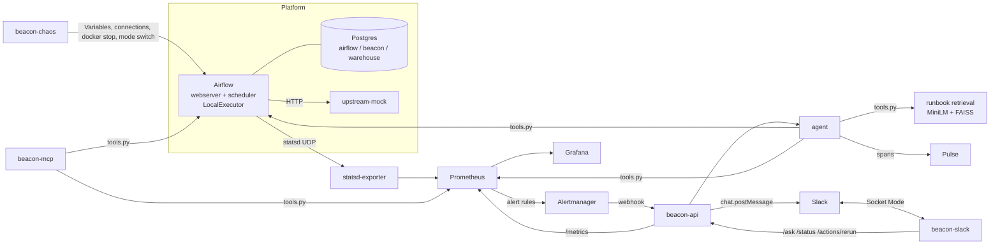

# Architecture

Beacon watches a small Airflow data platform, notices when something breaks, works out why
with an LLM agent, and tells the people affected in Slack. This document describes each
component and then follows one incident through the whole system.

## Components

### The mini data platform

| Piece | What it is |
|---|---|
| `airflow/` | Airflow 2.10.5 with the LocalExecutor (webserver + scheduler, no Celery/Redis). Five DAGs in `airflow/dags/`, shared helpers in `airflow/include/platform_lib.py`. |
| DAGs | `sales_daily_etl` (CSV → clean → aggregate → load), `user_events_ingest` (upstream API → validate → store), `feature_build`, `report_export`, `metrics_rollup`. Each has SLAs on its key task, `retries=1`, and logs the evidence a human would want when it fails. |
| Fault switches | Airflow Variables (`fault_bad_code`, `fault_resource_exhaustion`, `sales_load_conn_id`). The DAG code reads them at run time, so the chaos CLI never edits code. |
| `upstream_mock/` | A FastAPI service with three modes (`healthy`, `down` = 503, `slow` = 30 s delay) switched through `POST /admin/mode`. |
| Postgres | One instance, three databases: `airflow` (metadata), `beacon` (incidents, fault injections, eval metrics) and `warehouse` (what the pipelines load). |

### Monitoring

* Airflow emits statsd metrics to **statsd-exporter**; `statsd/mapping.yml` turns dotted
  names like `airflow.ti.finish.sales_daily_etl.extract.failed` into
  `airflow_ti_finish{dag_id="sales_daily_etl",task_id="extract",state="failed"}`.
* **Prometheus** scrapes statsd-exporter, beacon-api and itself every 15 s and evaluates
  `prometheus/rules/beacon.yml`: `DagRunFailed`, `TaskFailureSpike`, `SLAMissed`,
  `SchedulerHeartbeatMissing`, `TaskDurationAnomaly`.
* **Alertmanager** groups by `alertname, dag_id, task_id`, waits 5 s, and posts firing and
  resolved notifications to `beacon-api`. It re-sends still-firing alerts every minute;
  beacon-api drops repeats for a run it has already seen, so a *new* failed run of a DAG
  whose alert is still firing still becomes its own incident.
* **Grafana** is provisioned from `grafana/` with two dashboards and anonymous read access.

### beacon (core package)

| Module | Responsibility |
|---|---|
| `tools.py` | The one implementation of every investigation tool, their argument schemas (Pydantic), the PromQL guard, log cleaning and secret masking. `AGENT_TOOLS` is the read-only set; `rerun_task` lives here too but is never registered with the agent or MCP. |
| `clients.py` | Async clients for the Airflow REST API (`/api/v1`) and the Prometheus HTTP API. |
| `retrieval/` | Runbook loading (YAML front matter) and CRAG-style retrieval: FAISS top-k → grade → one rewrite from evidence → filtered results. |
| `agent/llm.py` | OpenAI-compatible chat client configured only by `LLM_BASE_URL`, `LLM_MODEL`, `LLM_API_KEY`. Handles 429 with exponential backoff that honours `Retry-After`. |
| `agent/loop.py` | The tool-calling loop: up to 8 LLM rounds, per-tool timeout, schema-checked tool arguments, final JSON validated against `Diagnosis` with one retry, a forced final answer if the cap is hit. |
| `agent/triage.py` | Classifies `/ask` questions into `job_failure`, `job_slow`, `how_to`, `other` (LLM with keyword fallback). |
| `api/` | FastAPI app (`main.py`), the incident lifecycle (`service.py`) and the Slack notifier. |
| `store/` | SQLAlchemy 2 models: `incidents`, `fault_injections`, `eval_metrics`. |
| `pulse.py` | Fail-open tracer that sends each agent run, LLM call and tool call to Pulse's ingest API. |
| `baseline.py` | Ordered regex rules from log text to root cause, used by the evaluation. |
| `security.py` | Masks tokens, passwords, URI credentials and configured secret values. |
| `slack_blocks.py` | Block Kit builders shared by beacon-api and beacon-slack. |

### beacon-slack

A Bolt app in Socket Mode. `/status`, `/why <dag_id> [run_id]` and `/runbook <query>`, plus
the incident buttons (Rerun → confirmation modal → allowlist check → `POST /actions/rerun`;
Acknowledge; Helpful/Not helpful; Show evidence). Handlers are plain functions in
`beacon_slack/handlers.py` so they can be unit-tested. Every path answers the user, including
when beacon-api, Airflow or the LLM is unavailable.

### beacon-mcp

FastMCP server exposing the seven read-only tools and every runbook as a `runbook://<id>`
resource, over stdio (local clients) or streamable HTTP at `:8200/mcp` (in compose). It
calls the same `tools.call_tool` path as the agent, so validation, the PromQL guard and
secret masking apply identically.

### beacon-chaos and beacon-eval

`chaos/` injects the eight scenarios (Variables, connections, upstream-mock mode, and the
Docker API for stopping the scheduler or filling its 8 MB reports tmpfs), records ground
truth in `fault_injections`, and triggers the affected DAG so demos don't wait for the
schedule. `eval/run.py` loops inject → wait for a triaged incident → score agent and baseline
→ reset → wait healthy, then writes JSON + a markdown report and pushes the accuracy gauges.

## Data flow for one incident

The example is `missing_input`: the sales CSV disappears from the landing directory.

1. **Injection.** `beacon-chaos inject missing_input` writes a `fault_injections` row
   (`ground_truth_cause=missing_upstream_data`, `expected_runbook=rb-missing-input`), moves
   `/opt/airflow/data/incoming/sales.csv` aside inside the scheduler container, and triggers
   `sales_daily_etl`.
2. **Failure.** `extract` logs `Input file … does not exist. Files present in …: []` and raises
   `FileNotFoundError`. It retries once after 10 s, fails again, and the run fails.
3. **Metrics.** Airflow sends `dagrun.duration.failed.sales_daily_etl` and
   `ti.finish.sales_daily_etl.extract.failed` to statsd-exporter; Prometheus scrapes them
   within 15 s.
4. **Alert.** `DagRunFailed{dag_id="sales_daily_etl"}` fires on the next rule evaluation.
   Alertmanager waits 5 s (`group_wait`) and posts the webhook.
5. **Incident.** `POST /webhooks/alertmanager` asks Airflow for the latest failed run of the
   DAG, which gives the run id and failed task. It deduplicates on `fingerprint + run_id` (and
   on `dag_id + run_id`, so `TaskFailureSpike` for the same run doesn't create a second
   incident), links the open fault injection whose time window contains the failure, stores
   an `open` incident and starts the agent in the background.
6. **Investigation.** The agent gets the alert, run id and failed task, then calls tools —
   typically `get_task_logs` → `search_runbooks` — and answers with a `Diagnosis` JSON. Each
   LLM call and tool call is a span in Pulse.
7. **Post.** beacon-api stores the diagnosis (`triaged`), posts the Block Kit message to
   `SLACK_INCIDENT_CHANNEL`, records the Slack `ts`, and observes `beacon_triage_seconds`.
8. **People.** Someone clicks *Show evidence*, then *Rerun task* once the file is back; the
   modal confirms, beacon-slack checks the allowlist, beacon-api checks it again and clears
   the task through Airflow's `clearTaskInstances`, and the result is posted in the thread.
9. **Resolution.** Five minutes without new failures, `DagRunFailed` resolves. Alertmanager
   sends `status=resolved`; beacon-api marks the incident `resolved`, edits the original
   Slack message (✅, no rerun button) and replies in the thread.
