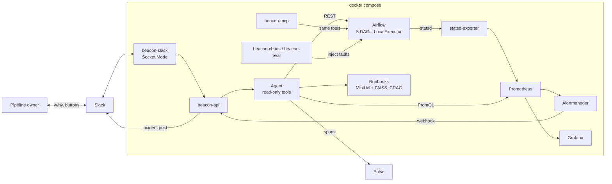

# Beacon — AI support copilot for a data platform

When a data pipeline breaks, the people who own it often find out late, from someone
downstream. Then they spend twenty minutes in Airflow logs only to learn it was "just" an
upstream API being down. Beacon closes that gap:

1. **Detects** failures: Prometheus alert rules on Airflow metrics.
2. **Investigates** them: an LLM agent with read-only tools reads run history, task logs,
   metrics and runbooks.
3. **Explains** them: a plain-English summary in Slack with the likely cause, the evidence and
   the matching runbook.
4. **Lets users help themselves**: `/platform-status`, `/why <dag>` and `/runbook <query>` in
   Slack, plus a human-confirmed, allowlisted **Rerun task** button.
5. **Shows trends**: two Grafana dashboards, one for pipeline owners and one for support.

The same investigation tools are exposed as an **MCP server**, and every agent run is traced
into **Pulse**.



More detail: [ARCHITECTURE.md](ARCHITECTURE.md) · [DECISIONS.md](DECISIONS.md) ·
[WALKTHROUGH.md](WALKTHROUGH.md)


## Evaluation results

`beacon-eval --runs 30 --seed 42`, run on 2026-10-22 against the full stack, real alerting
path included. The model was `gemini-3.5-flash-lite` (Gemini free tier, `LLM_REASONING_EFFORT=low`).
Each run injects a random scenario, waits for the triaged incident, scores it, resets, and
waits for the platform to be healthy. Raw data:
[`eval/results/20261022T190517Z.json`](eval/results/20261022T190517Z.json); report:
[`eval/results/20261022T190517Z.md`](eval/results/20261022T190517Z.md).

| | Root cause | Runbook |
|---|---|---|
| **Beacon agent** | **100%** (30/30) | **100%** (30/30) |
| Rule-based baseline | 100% (30/30) | 100% (30/30) |

| Latency | p50 | p95 |
|---|---|---|
| Fault injected → diagnosis posted in Slack | 61.4 s | 111.7 s |
| Alert received → diagnosis posted (triage) | 14.4 s | 51.0 s |

| Scenario | Runs | Agent root cause | Agent runbook | Baseline |
|---|---|---|---|---|
| bad_code | 5 | 5/5 | 5/5 | 5/5 |
| bad_connection | 6 | 6/6 | 6/6 | 6/6 |
| disk_full | 3 | 3/3 | 3/3 | 3/3 |
| missing_input | 7 | 7/7 | 7/7 | 7/7 |
| resource_exhaustion | 3 | 3/3 | 3/3 | 3/3 |
| scheduler_down | 2 | 2/2 | 2/2 | 2/2 |
| upstream_down | 3 | 3/3 | 3/3 | 3/3 |
| upstream_slow | 1 | 1/1 | 1/1 | 1/1 |

The confusion matrix is diagonal, with no timeouts and no harness errors. The agent averaged
3.8 LLM rounds per investigation (cap 8), with mean confidence 0.99 (min 0.95). Nothing hit
a free-tier rate-limit failure.

**How to read this honestly:**
* The baseline also scores 100%. These eight faults are clean and synthetic, and each leaves
  one unambiguous error line, which a dozen regexes can match. The evaluation shows the
  agent is *reliable* on them. It does not show the agent is *needed* for them. What the
  agent adds over the baseline is the rest of the job: it finds the failed run and task, reads
  the right log, explains the cause to a pipeline owner in plain English, and picks the
  runbook. Unlike a fixed rule list, it can also say "unknown" on inputs nobody wrote a rule
  for (see [DECISIONS.md](DECISIONS.md)).
* Some scenarios got few draws (`upstream_slow` once, `scheduler_down` twice) because the
  seeded random choice is uniform over scenarios, not stratified.
* Most of the end-to-end time is the platform, not the agent. A failing run takes 15–40 s
  including Airflow's retry, then about 15 s for the scrape and rule evaluation and 5 s of
  Alertmanager `group_wait`. In the four runs over 90 s, three spent 67–111 s *before* the
  alert reached Beacon (`scheduler_down` needs 60 s without a heartbeat; the other two
  waited on the platform). One (#15) had a slow 59 s triage. Beacon logged zero 429s
  during the run.

| Platform Health | Support & Incidents |
|---|---|
|  |  |

## Quickstart

Requirements: Docker Desktop (Windows with the WSL2 backend, or macOS) or Docker Engine +
Compose v2 on Linux. Give Docker about 6 GB of memory.

```bash
cp .env.example .env          # then add an LLM key (next section)
docker compose up -d --build  # first build downloads ~2 GB (torch CPU, Airflow image)
```

| Service | URL |
|---|---|
| Airflow UI / API | http://localhost:8080 (admin / admin) |
| Grafana | http://localhost:3001 (anonymous viewer; admin / admin to edit) |
| beacon-api (Swagger) | http://localhost:8100/docs |
| beacon-mcp (streamable HTTP) | http://localhost:8200/mcp |
| Prometheus / Alertmanager | http://localhost:9090 / http://localhost:9093 |
| upstream-mock | http://localhost:8300/admin/mode |

The five DAGs start running green within a minute. Without an LLM key everything still
works except the diagnosis: incidents are created and posted with an "unknown — investigate
manually" message.

## Choosing the LLM (free options)

Beacon talks to any OpenAI-compatible endpoint, configured only by `LLM_BASE_URL`,
`LLM_MODEL` and `LLM_API_KEY`. Switching provider is a `.env` change; no code changes.

**Groq (default):** create a free key at https://console.groq.com/keys (no card). Pick a model
that supports tool calling from `GET https://api.groq.com/openai/v1/models`.
```
LLM_BASE_URL=https://api.groq.com/openai/v1
LLM_MODEL=<tool-calling model from Groq's list>
LLM_API_KEY=gsk_...
```

**Google Gemini free tier:** create a key at https://aistudio.google.com/apikey. The evaluation
below used `gemini-3.5-flash-lite`. `gemini-3.5-flash` worked too, but its free tier allows
only 5 requests/minute.
```
LLM_BASE_URL=https://generativelanguage.googleapis.com/v1beta/openai/
LLM_MODEL=gemini-3.5-flash-lite
LLM_API_KEY=<your key>
LLM_REASONING_EFFORT=low
```

**Local Ollama:** `ollama pull <a model with tool support>`, then:
```
LLM_BASE_URL=http://host.docker.internal:11434/v1
LLM_MODEL=<model>
LLM_API_KEY=ollama
LLM_TIMEOUT_SECONDS=300
```
Use a model that emits native tool calls (some older 7B models write the call as text,
which the agent can't use), and raise Ollama's context window (`OLLAMA_CONTEXT_LENGTH=8192`).
The 4096-token default silently drops the system prompt. CPU-only inference works but is
slow.

Free tiers are rate-limited. The client retries 429s with exponential backoff and honours
the provider's delay (`Retry-After`, or Gemini's `retryDelay` in the error body). Tool output
is trimmed (library traceback frames collapsed, log tail only), and `beacon-eval` pauses
between runs.

## Slack setup (about 5 minutes)

1. https://api.slack.com/apps → **Create New App** → **From an app manifest** → pick your
   workspace → paste [`slack/manifest.yml`](slack/manifest.yml) → **Create**.
2. **Install App** → **Install to Workspace**. Copy the *Bot User OAuth Token* (`xoxb-…`) into
   `SLACK_BOT_TOKEN`.
3. **Basic Information** → **App-Level Tokens** → **Generate** with the `connections:write`
   scope. Copy the `xapp-…` token into `SLACK_APP_TOKEN`.
4. In Slack, open the channel for incidents. Click its name, and at the bottom of **About**
   copy the **Channel ID** (`C…`) into `SLACK_INCIDENT_CHANNEL`. Then `/invite @beacon` in
   that channel.
5. Your profile → **⋮** → **Copy member ID** (`U…`). Put the IDs of people who may rerun
   tasks, comma-separated, into `RERUN_ALLOWED_USERS`.
6. `docker compose up -d beacon-api beacon-slack`

Commands: `/platform-status`, `/why <dag_id> [run_id]`, `/runbook <what you see>`. (Slack
reserves `/status`, hence `/platform-status`.)

## MCP setup

The server exposes seven read-only tools (`get_platform_status`, `list_recent_failures`,
`get_dag_run`, `get_task_logs`, `query_prometheus`, `search_runbooks`, `get_runbook`) and
every runbook as a `runbook://<id>` resource.

**Claude Code**, using the HTTP server already running in compose:
```bash
claude mcp add --transport http beacon http://localhost:8200/mcp
```

**Claude Desktop** (`claude_desktop_config.json`), using stdio through the container:
```json
{
  "mcpServers": {
    "beacon": {
      "command": "docker",
      "args": ["compose", "-f", "C:/path/to/beacon/docker-compose.yml", "run", "--rm", "-T",
               "tools", "beacon-mcp"]
    }
  }
}
```
Or run it from a local install (`pip install -e .`) with
`"command": "beacon-mcp"` and `AIRFLOW_URL=http://localhost:8080`,
`PROMETHEUS_URL=http://localhost:9090` in `env`.

**Example conversation** (the tool results are real output from the running stack, trimmed):

> **You:** Something in the data platform failed in the last half hour. What broke and why?
>
> **Claude** calls `list_recent_failures(since_minutes=30)` →
> ```json
> {"dag_id": "feature_build", "run_id": "manual__2026-10-22T19:09:59.329692+00:00",
>  "failed_tasks": [{"task_id": "compute_features", "state": "failed", "try_number": 2, "duration_s": 8.8}],
>  "upstream_failed": ["write_features"]}
> ```
> then `get_task_logs(dag_id="feature_build", run_id="manual__2026-10-22T19:09:59.329692+00:00", task_id="compute_features", tail_lines=8)` →
> ```
> 19:10:29 INFO - Interaction matrix buffer at 100 MB (rss=258 MB)
> 19:10:29 INFO - Interaction matrix buffer at 120 MB (rss=278 MB)
> 19:10:30 INFO - Interaction matrix buffer at 140 MB (rss=298 MB)
> 19:10:30 INFO - Task exited with return code -9. For more information, see …#LocalTaskJob-killed
> ```
> then `search_runbooks(query="Task exited with return code -9 after memory grew", k=2)` →
> ```json
> {"results": [{"runbook_id": "rb-resource", "title": "Task killed for running out of memory", "score": 0.634}]}
> ```
>
> **Claude:** `feature_build` failed in `compute_features`: the task's memory grew to about
> 300 MB while building a dense interaction matrix, and it was killed (exit code -9, i.e.
> SIGKILL), on both tries. `write_features` didn't run. Runbook `rb-resource` says to
> process the data in chunks instead of materialising the whole matrix. As a stopgap, give
> the task more memory, then rerun it.

## Demo script

```bash
# 1. Break something (records ground truth and triggers the DAG right away)
docker compose run --rm tools beacon-chaos inject missing_input

# 2. About 60-90 s later an incident post appears in the Slack channel:
#    "🔴 sales_daily_etl: pipeline run failed" with summary, cause, evidence, runbook, buttons.

# 3. In Slack
/why sales_daily_etl          # "Looking into it…" then the diagnosis in a thread
/platform-status              # scheduler + per-DAG success rate + open incidents
/runbook file not found

# 4. Fix it, then press "Rerun task" on the post (confirm; allowlisted users only)
docker compose run --rm tools beacon-chaos reset

# 5. Grafana: http://localhost:3001 → Beacon → Platform Health / Support & Incidents
#    About 5 minutes after the last failure the alert resolves and the Slack post turns ✅.
```

All scenarios: `docker compose run --rm tools beacon-chaos list`

| Scenario | Injected by | Ground truth | Runbook |
|---|---|---|---|
| `bad_code` | Variable makes `clean` read a renamed field → `KeyError` | `code_error` | `rb-code-error` |
| `missing_input` | sales CSV moved out of the landing dir | `missing_upstream_data` | `rb-missing-input` |
| `upstream_down` | upstream-mock returns 503 | `dependency_unavailable` | `rb-upstream-down` |
| `upstream_slow` | upstream-mock waits 30 s → client timeout | `dependency_latency` | `rb-upstream-slow` |
| `bad_connection` | load pointed at a connection with stale credentials | `credentials_or_connection` | `rb-connection` |
| `resource_exhaustion` | `compute_features` allocates until killed (exit -9) | `resource_limit` | `rb-resource` |
| `scheduler_down` | scheduler container stopped | `scheduler_unhealthy` | `rb-scheduler` |
| `disk_full` | 8 MB reports volume filled | `storage_full` | `rb-disk-full` |

## Running the evaluation

```bash
docker compose run --rm -T tools beacon-eval --runs 30 --seed 42
```
It writes `eval/results/<timestamp>.json` and `.md`, and pushes the accuracy gauges to
beacon-api, so Grafana's *Support & Incidents* dashboard shows them.

## Pulse tracing

Set `PULSE_URL` (e.g. `http://host.docker.internal:8000`) and `PULSE_API_KEY` (a `ps_…`
project key from Pulse → Settings). Every investigation becomes a trace: a root `agent` span
with an `llm` span per model call and a `tool` span per tool call. With `PULSE_URL` empty,
tracing is a no-op.

## Tests

```bash
pip install -e ".[dev]"
python scripts/fetch_model.py   # optional: caches the embedding model locally
pytest
```
No API keys are needed. Airflow, Prometheus, Slack and the LLM are mocked (respx, a scripted
fake LLM). Retrieval tests use the real MiniLM model.

## Troubleshooting

* **Image build fails downloading the embedding model** (`CERTIFICATE_VERIFY_FAILED` for
  huggingface.co, e.g. behind a TLS-intercepting proxy): run `python scripts/fetch_model.py`
  on the host, then rebuild. The Dockerfile uses `./models` when present.
* **pip timeouts during the build** on a slow connection: rerun `docker compose build`. The
  layers that already finished are cached.
* **`/why` says the model is unavailable**: check `LLM_*` in `.env` and
  `docker compose logs beacon-api`. The free-tier limits differ per model.

## Layout

```
airflow/        Airflow image, 5 DAGs, fault-switch helpers
upstream_mock/  fake external API with healthy/down/slow modes
prometheus/     scrape config + alert rules      alertmanager/  webhook routing
statsd/         statsd → Prometheus mapping      grafana/       provisioned datasource + 2 dashboards
beacon/         core: api/, agent/, tools.py, retrieval/, store/, pulse.py, baseline.py
beacon_slack/   Bolt app (Socket Mode)           beacon_mcp/    FastMCP server
chaos/          fault injection CLI              eval/          evaluation harness + results
runbooks/       12 runbooks (8 scenarios + 4 distractors)
tests/          pytest suite                     slack/         app manifest
```
