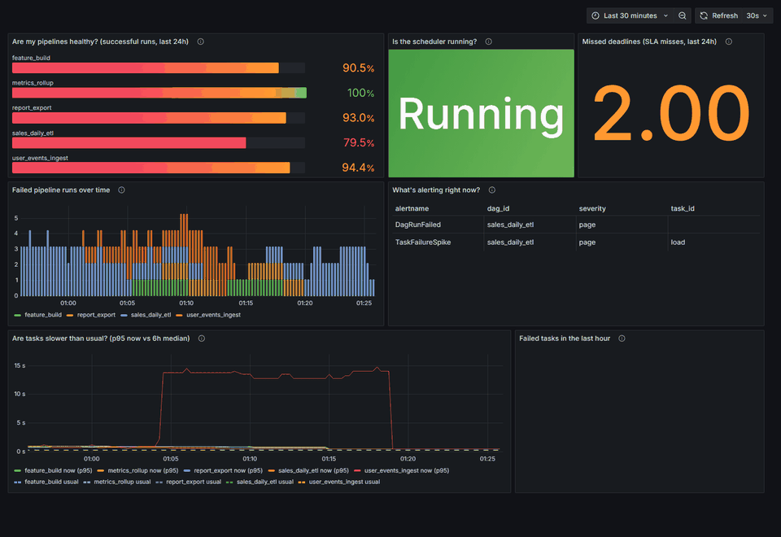
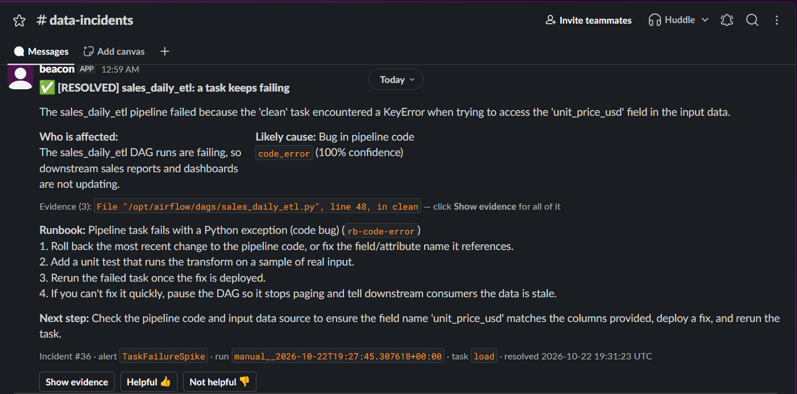
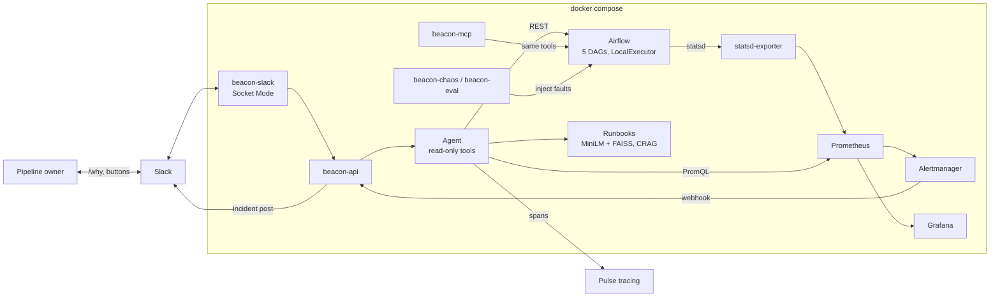
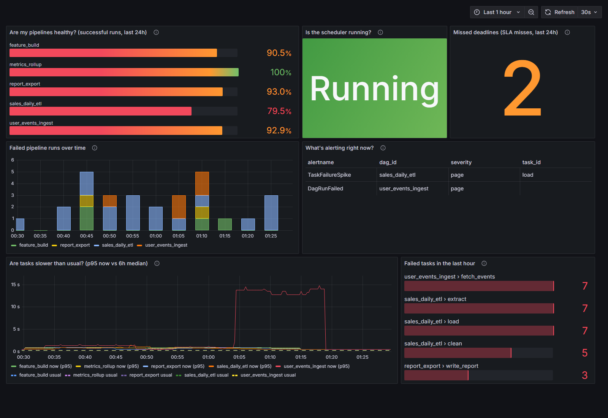
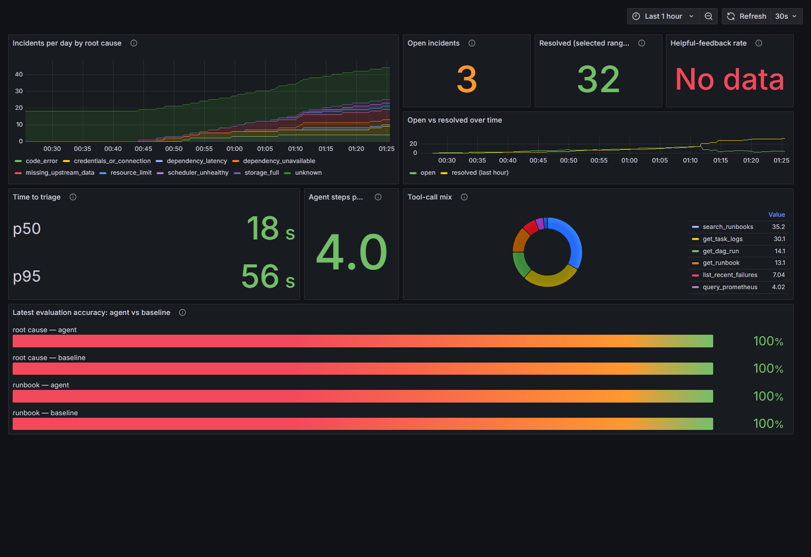

# Beacon

**An AI support copilot for an Airflow data platform.** When a pipeline breaks, Beacon notices,
investigates the logs and metrics with a tool-using LLM agent, and posts a plain-English
diagnosis to Slack, with the evidence and the runbook to fix it.



**Results:** 30 fault-injection runs end to end; the root cause and runbook were right in all 30.
Median time from fault to Slack post: 61 s. ([details](#evaluation))



---

## Why

Pipeline owners usually learn about failures late, from someone downstream. Then they spend
twenty minutes in Airflow logs to discover it was "just" an upstream API being down. Beacon
closes that gap:

| | |
|---|---|
| **Detect** | Prometheus alert rules on Airflow metrics (failed runs, failure spikes, SLA misses, scheduler heartbeat, slow tasks) |
| **Investigate** | An LLM agent with seven read-only tools reads run history, task logs, metrics and runbooks |
| **Explain** | A Slack post written for the pipeline owner: what broke, who is affected, likely cause + confidence, evidence, runbook steps |
| **Self-serve** | `/platform-status`, `/why <dag>`, `/runbook <query>`, plus a human-confirmed, allowlisted **Rerun task** button |
| **Observe** | Two Grafana dashboards, and every agent run traced as spans |

The same tools are also exposed through an **MCP server**, so any MCP client can investigate
the platform interactively.

## How it works



1. A chaos CLI breaks the platform in one of eight realistic ways (bad code, missing input,
   upstream down or slow, bad credentials, out of memory, scheduler down, disk full).
2. Airflow metrics trip a Prometheus alert. Alertmanager calls `beacon-api`, which finds
   the failed run, deduplicates it, and opens an incident.
3. The agent investigates with read-only tools (at most 8 steps). It must return
   schema-validated JSON (cause, confidence, evidence, runbook) or say "unknown".
4. The diagnosis is posted to Slack. When the alert resolves, the post is updated.

**Safety by design:** the agent can only read. Rerunning a task requires a button click, a
confirmation modal and an allowlisted user, checked in both the bot and the API. PromQL is
range- and size-capped, no tool can run shell commands, and secrets are masked before
anything reaches the LLM or Slack.

More detail: [ARCHITECTURE.md](ARCHITECTURE.md) (components and data flow) ·
[DECISIONS.md](DECISIONS.md) (trade-offs) · [WALKTHROUGH.md](WALKTHROUGH.md) (one real
incident, traced step by step)

## Tech stack

Python 3.11 · FastAPI · Pydantic v2 · SQLAlchemy 2 · Apache Airflow 2.10 · Prometheus ·
Alertmanager · Grafana · Postgres · sentence-transformers (MiniLM) + FAISS · Slack Bolt
(Socket Mode) · MCP Python SDK (FastMCP) · OpenAI-compatible LLM client (Groq / Gemini /
Ollama) · Docker Compose · pytest + respx

## Evaluation

`beacon-eval --runs 30 --seed 42` injects a random fault, waits for Beacon's diagnosis to
arrive through the real alerting path, scores it against the recorded ground truth, resets,
and repeats. It also runs a rule-based (regex) baseline on the same logs.

Model: `gemini-3.5-flash-lite` (Gemini free tier). Raw data:
[`eval/results/20261022T190517Z.json`](eval/results/20261022T190517Z.json) · report:
[`eval/results/20261022T190517Z.md`](eval/results/20261022T190517Z.md)

| | Root cause | Runbook |
|---|---|---|
| **Beacon agent** | **30/30 (100%)** | **30/30 (100%)** |
| Rule-based baseline | 30/30 (100%) | 30/30 (100%) |

| Latency | p50 | p95 |
|---|---|---|
| Fault injected → diagnosis posted in Slack | 61.4 s | 111.7 s |
| Alert received → diagnosis posted | 14.4 s | 51.0 s |

| Scenario | Runs | Agent: cause | Agent: runbook | Baseline |
|---|---|---|---|---|
| bad_code | 5 | 5/5 | 5/5 | 5/5 |
| bad_connection | 6 | 6/6 | 6/6 | 6/6 |
| disk_full | 3 | 3/3 | 3/3 | 3/3 |
| missing_input | 7 | 7/7 | 7/7 | 7/7 |
| resource_exhaustion | 3 | 3/3 | 3/3 | 3/3 |
| scheduler_down | 2 | 2/2 | 2/2 | 2/2 |
| upstream_down | 3 | 3/3 | 3/3 | 3/3 |
| upstream_slow | 1 | 1/1 | 1/1 | 1/1 |

Every run completed with no timeouts. The agent averaged 3.8 LLM steps per investigation
(cap 8) with mean confidence 0.99.

The rule-based baseline gives a deterministic reference point and a regression floor for
every prompt or model change. On top of classifying the cause, the agent locates the failed
run and task itself, explains the impact in plain English, and picks the runbook.

| Platform Health | Support & Incidents |
|---|---|
|  |  |

## Quickstart

Requirements: Docker Desktop (Windows/WSL2 or macOS) or Docker Engine + Compose v2 on Linux,
with about 6 GB of memory for Docker.

```bash
cp .env.example .env           # add an LLM key, see below
docker compose up -d --build   # first build downloads ~2 GB
```

| Service | URL |
|---|---|
| Airflow | http://localhost:8080 (admin / admin) |
| Grafana | http://localhost:3001 |
| beacon-api (Swagger) | http://localhost:8100/docs |
| beacon-mcp | http://localhost:8200/mcp |
| Prometheus / Alertmanager | http://localhost:9090 · http://localhost:9093 |

The five DAGs run green within a minute. Beacon degrades gracefully: without an LLM key,
incidents are still created, deduplicated and posted for manual follow-up.

### Try it

```bash
docker compose run --rm tools beacon-chaos list                  # the 8 scenarios
docker compose run --rm tools beacon-chaos inject missing_input  # break something
# ~60-90 s later: an incident post in Slack, with cause, evidence and runbook
docker compose run --rm tools beacon-chaos reset                 # fix everything
```

Then in Slack: `/why sales_daily_etl`, `/platform-status`, `/runbook file not found`, or
**Rerun task** on the post.

| Scenario | How it's injected | Ground truth |
|---|---|---|
| `bad_code` | a transform reads a renamed field → `KeyError` | `code_error` |
| `missing_input` | the sales CSV is moved out of the landing directory | `missing_upstream_data` |
| `upstream_down` | the upstream API returns 503 | `dependency_unavailable` |
| `upstream_slow` | the upstream API waits 30 s → client timeout | `dependency_latency` |
| `bad_connection` | the load points at a connection with stale credentials | `credentials_or_connection` |
| `resource_exhaustion` | a task allocates memory until it is killed | `resource_limit` |
| `scheduler_down` | the scheduler container is stopped | `scheduler_unhealthy` |
| `disk_full` | the 8 MB reports volume is filled | `storage_full` |

Run the evaluation yourself with
`docker compose run --rm -T tools beacon-eval --runs 30 --seed 42`.

## Configuration

### LLM (free options)

Any OpenAI-compatible endpoint works, configured only through `.env`:

| Provider | `.env` |
|---|---|
| **Groq** (default; free key at console.groq.com) | `LLM_BASE_URL=https://api.groq.com/openai/v1` · `LLM_MODEL=<a tool-calling model>` · `LLM_API_KEY=gsk_…` |
| **Gemini** (free key at aistudio.google.com) | `LLM_BASE_URL=https://generativelanguage.googleapis.com/v1beta/openai/` · `LLM_MODEL=gemini-3.5-flash-lite` · `LLM_API_KEY=…` · `LLM_REASONING_EFFORT=low` |
| **Ollama** (local) | `LLM_BASE_URL=http://host.docker.internal:11434/v1` · `LLM_MODEL=<model>` · `LLM_API_KEY=ollama` · `LLM_TIMEOUT_SECONDS=300` |

The client retries rate-limited requests with exponential backoff and honours the
provider's retry delay, so the free tiers are enough for the full 30-run evaluation.

### Slack (about 5 minutes)

1. At api.slack.com/apps: **Create New App** → **From an app manifest** → paste
   [`slack/manifest.yml`](slack/manifest.yml).
2. **Install App** → copy the bot token (`xoxb-…`) into `SLACK_BOT_TOKEN`.
3. **Basic Information** → **App-Level Tokens** → generate one with `connections:write` →
   copy it (`xapp-…`) into `SLACK_APP_TOKEN`.
4. Copy the incident channel's ID (channel name → About → Channel ID) into
   `SLACK_INCIDENT_CHANNEL`, then `/invite @beacon` in that channel.
5. Copy the member IDs of people allowed to rerun tasks (Profile → ⋮ → Copy member ID)
   into `RERUN_ALLOWED_USERS`.
6. `docker compose up -d beacon-api beacon-slack`

Socket Mode means no public URL is needed. (Slack reserves `/status`, hence `/platform-status`.)

### MCP

Seven read-only tools (`get_platform_status`, `list_recent_failures`, `get_dag_run`,
`get_task_logs`, `query_prometheus`, `search_runbooks`, `get_runbook`), and every runbook as a
`runbook://<id>` resource.

- **HTTP**: point your MCP client at `http://localhost:8200/mcp` (streamable HTTP).
- **stdio**: add this to your client's MCP server config:

```json
{
  "mcpServers": {
    "beacon": {
      "command": "docker",
      "args": ["compose", "-f", "/path/to/Beacon/docker-compose.yml",
               "run", "--rm", "-T", "tools", "beacon-mcp"]
    }
  }
}
```

<details>
<summary>Example session (real tool output from the running stack)</summary>

> **User:** Something failed in the last half hour. What broke and why?
>
> `list_recent_failures(since_minutes=30)` →
> ```json
> {"dag_id": "feature_build", "run_id": "manual__2026-10-22T19:09:59.329692+00:00",
>  "failed_tasks": [{"task_id": "compute_features", "state": "failed", "try_number": 2}],
>  "upstream_failed": ["write_features"]}
> ```
> `get_task_logs(dag_id="feature_build", run_id=…, task_id="compute_features", tail_lines=8)` →
> ```
> 19:10:29 INFO - Interaction matrix buffer at 120 MB (rss=278 MB)
> 19:10:30 INFO - Interaction matrix buffer at 140 MB (rss=298 MB)
> 19:10:30 INFO - Task exited with return code -9. … #LocalTaskJob-killed
> ```
> `search_runbooks(query="Task exited with return code -9 after memory grew", k=2)` →
> ```json
> {"results": [{"runbook_id": "rb-resource", "title": "Task killed for running out of memory", "score": 0.634}]}
> ```
>
> **Assistant:** `feature_build` failed in `compute_features`. Its memory grew to about
> 300 MB while it built a dense interaction matrix, and it was killed (exit -9, SIGKILL) on
> both tries, so `write_features` never ran. Per `rb-resource`, process the data in chunks.
> As a stopgap, give the task more memory and rerun it.

</details>

### Tracing

Set `PULSE_URL` and `PULSE_API_KEY` to send every investigation to Pulse as a trace: a root
agent span with one span per LLM call and per tool call. If `PULSE_URL` is empty, tracing
is disabled.

## Tests

```bash
pip install -e ".[dev]"
pytest
```

The suite runs with no API keys: Airflow, Prometheus, Slack and the LLM are mocked (respx and
a scripted fake LLM). It covers:
- the tools and the PromQL guard
- webhook dedupe and resolution
- the agent's retry and step cap
- retrieval for every runbook
- the Slack handlers, including the rerun allowlist
- the chaos CLI and the MCP server

## Repository layout

```
airflow/         Airflow image, 5 DAGs, fault-switch helpers
upstream_mock/   fake external API (healthy / down / slow)
prometheus/      scrape config and alert rules
alertmanager/    webhook routing
statsd/          statsd → Prometheus metric mapping
grafana/         provisioned datasource and two dashboards
beacon/          core: api/, agent/, tools.py, retrieval/, store/, pulse.py, baseline.py
beacon_slack/    Slack bot (Bolt, Socket Mode)
beacon_mcp/      MCP server
chaos/           fault-injection CLI
eval/            evaluation harness and results
runbooks/        12 runbooks (8 scenarios + 4 distractors)
tests/           pytest suite
```
